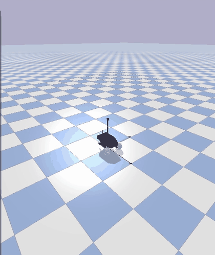

# COMP0245 Final Task: Robotnik Mobile Manipulator (branch `ricktho`: MLP policy with DAgger)

A simulated Robotnik mobile manipulator (4-wheel skid-steer base + 7-DoF Kinova arm, PyBullet + Pinocchio) must drive to a 3D target and reach it with its gripper. A model-based expert controller solves the task. The goal is a learned model that produces the wheel commands and arm torques from measurements of the robot state.

This branch contains the **MLP policy trained with Dataset Aggregation (DAgger)**. The other group approaches are on their own branches: decoupled linear regression on `shivansh/linear_regression`, random forest on `hafizh/random_forest`.

<p align="center">
  
</p>

**Result:** from a random spawn (x, y ∈ [−2, 2] m, any heading), with no expert involvement, the learned policy reaches **99.1 %** of 1000 random targets 2.0–4.0 m away within 5 cm (median error 16 mm), and 90.0 % when targets as close as 0.9 m are included. On the same 2.0–4.0 m cases, run with the linear model's own test script `test_combined_random.py`, the linear-regression model reaches 97.0 %. The method, the results and how to reproduce them are in [`robotnik_arm_task/robotnik_dagger_v5/README.md`](robotnik_arm_task/robotnik_dagger_v5/README.md).

## Repository layout

```text
Machine-Learning-Final-Task/
├── RoboEnv/                       simulation environment from the labs (Pixi manifest, simulation_and_control,
│                                  robot models/ and configs/)
├── robotnik_arm_task/
│   ├── robotnik_arm_task.py       expert simulation: one episode with the model-based controller (GUI or headless)
│   ├── robotnik_arm_control.py    expert controllers used by robotnik_arm_task.py
│   ├── collect_data.py            records the expert demonstrations -> data_randomized/
│   ├── data_randomized/           2000 demonstration episodes (not in git, created by collect_data.py)
│   ├── models, configs            links to RoboEnv/models and RoboEnv/configs
│   └── robotnik_dagger_v5/        the DAgger policy: code, trained model, evaluation, figures, demo video
│                                  (see its README; also links to RoboEnv/models and RoboEnv/configs)
└── README.md                      this file
```

## Setup

The simulation environment is included in `RoboEnv/`. Install [Pixi](https://pixi.sh), then create and activate the `ml` environment (Python 3.12 with PyTorch, PyBullet, Pinocchio and the bundled `simulation_and_control` package):

```bash
cd RoboEnv
pixi install -e ml        # first time only, downloads a few GB
pixi shell -e ml          # activates the environment in this terminal
cd ../robotnik_arm_task
```

Check the environment with `python -c "import torch, pybullet, simulation_and_control"`. The robot models and configs need no copying: `robotnik_arm_task/` and `robotnik_arm_task/robotnik_dagger_v5/` contain links to `RoboEnv/models` and `RoboEnv/configs` (on Windows, enable symlinks in git or copy the two folders there).

## How to run the code

Each step starts from `robotnik_arm_task/`, in the terminal where `pixi shell -e ml` is active. Set `ROBOENV_HEADLESS=1` to run a simulation without the PyBullet window.

**1. Watch the expert.** One episode of the model-based controller, which drives to the target (red dot) and reaches it:
```bash
python robotnik_arm_task.py
```
Set `TARGET_EE_POS` at the top of the file to change the target. Output: the PyBullet window and the final end-effector error in the terminal; no files.

**2. Record demonstrations.** 2000 expert episodes, each with:
- a random target (radius 0.9–1.8 m around the origin, height 0.3–0.9 m);
- a random base start (±0.25 m, any yaw);
- random arm start angles (±0.1 rad per joint).

The state and the expert's commands are logged every 10 ms.
```bash
python collect_data.py                      # -> data_randomized/
python collect_data.py --num-episodes 5 --output-dir /tmp/check   # quick test
```
The same seed reproduces the same tasks and start states (`targets.csv`). Tiny numerical differences in the physics can still make individual torque spikes differ between runs. Output: `data_randomized/targets.csv` (one row per episode: target, start pose, seed) and `data_randomized/episode_XXXX.csv` (robot state, expert torques and wheel commands every 10 ms).

**3. Train and evaluate the DAgger policy.** Three DAgger rounds, training, and evaluation on 1000 random episodes, with progress bars and resumable stages (about 4 h with 6 workers; finished stages are skipped):
```bash
cd robotnik_dagger_v5
bash run_v6_pipeline.sh            # or one stage: r0 train_r0 r1 train_r1 r2 train_r2 eval
```
Outputs, all in `robotnik_dagger_v5/`:

| Stage | Generates |
|---|---|
| `r0`, `r1`, `r2` (collection) | `arm_dagger_v6_r0/`, `_r1/`, `_r2/`: one CSV per rollout with the visited states and the expert's labels, plus `collect_summary.csv` (not in git, about 4 GB) |
| `train_r0`, `train_r1`, `train_r2` | `trained_model_dagger_v6_r0/`, `_r1/` and the final `trained_model_dagger_v6/`: `wheel.pth`, `arm_hold.pth`, `arm_reach.pth`, `*_training_history.csv`, `v6_metadata.json` (feature scaling and settings); parsed-data cache in `cache_v6/` |
| `eval` | `eval_v6/linear_protocol/{v6,r0,r1}/deploy_summary.csv` (one row per test episode: final error, success, time, inference time), `eval_v6/examples/`, `eval_v6/inference_benchmark.json`, the figures `figures/v6_*.pdf` / `.png`, and all metrics in `figures/v6_results.json` |

The comparison with the linear-regression model (`compare_with_linear.py`) writes `figures/linear_vs_dagger_2to4.{pdf,png,json}`. Its commands are in the [DAgger README](robotnik_arm_task/robotnik_dagger_v5/README.md#comparison-with-the-linear-regression-model).

**4. Run the trained policy** in the GUI on a random target and spawn:
```bash
cd robotnik_dagger_v5
python run_robotnik_v6.py --random-target --random-spawn --seed $RANDOM
python run_robotnik_v6.py --target 1.2 -0.8 0.6 --spawn-position -1.5 1.5 3.0   # chosen target and spawn
```
Output: the PyBullet window, `SUCCESS` or `FAIL` with the final error in the terminal, and a JSON report in `custom_target_demo/` (`--save-trajectory` also saves the per-step CSV).

**Check the samplers:** `python test_random_sampling.py` in `robotnik_dagger_v5/` prints `sampler tests passed`.

## Code sources

| Part | Origin | What we did with it |
|---|---|---|
| `RoboEnv/` (with `simulation_and_control`, the robot `models/` and `configs/`) | COMP0245 lab environment: [VModugno/RoboEnv](https://github.com/VModugno/RoboEnv), [VModugno/simulation_and_control](https://github.com/VModugno/simulation_and_control) | unchanged copy, bundled so the repository runs on its own |
| `robotnik_arm_task/robotnik_arm_task.py`, `robotnik_arm_control.py`, `configs/robotnik_arm.json` | provided with the final task (first commit of the repository) | unchanged; this is the expert |
| `robotnik_dagger_v5/robotnik_arm_control.py`, `robotnik_arm.json` | copies of the provided expert and config | code unchanged; only comments and docstrings added |
| `robotnik_arm_task/collect_data.py` | the group's first collector (200 random targets, robot always starting from the default pose) | rewritten: random base start poses and arm start angles added, 2000 episodes, command-line options, one process per episode |
| `robotnik_dagger_v5/robotnik_dagger_collect.py` | the simulation setup (`SimInterface`, `PinWrapper`, command loop) follows `robotnik_arm_task.py` | written from scratch: DAgger β-mixing of learner and expert, expert labels for every visited state, deployment/evaluation mode, random spawns, parallel workers, resume |
| `robotnik_dagger_v5/make_linear_protocol_cases.py` | the random draws and their order are copied from `test_combined_random.py` (branch `shivansh/linear_regression`), so the test cases are identical | written from scratch around that |
| `dagger_common.py`, `v6_features.py`, `train_v6.py`, `run_robotnik_v6.py`, `plot_v6_results.py`, `compare_with_linear.py`, `benchmark_inference.py`, `test_random_sampling.py`, `run_v6_pipeline.sh`, `run_v6_evaluation.sh` (all in `robotnik_dagger_v5/`) | – | written from scratch |

Libraries used: PyTorch (networks and training), NumPy, pandas, Matplotlib, tqdm, and PyBullet and Pinocchio through `simulation_and_control`. DAgger follows Ross, Gordon and Bagnell, "A Reduction of Imitation Learning and Structured Prediction to No-Regret Online Learning", AISTATS 2011.

## Simulation variables

These are the variables in `robotnik_arm_task.py`:

| Variable | Meaning |
|---|---|
| `TARGET_EE_POS` | reach target (x, y, z) in the world frame, shown as a red dot |
| `base_pos`, `base_bearing` | base position (x, y, z) and heading (rad) |
| `q_mes`, `qd_mes` | arm joint angles (rad) and velocities (rad/s) |
| `wheel_cmds` | angular velocity command per wheel (rad/s) |
| `torque_arm` | torque command per arm joint (N·m), clipped to ±30 N·m by the controller |
| `torque_fingers` | gripper finger joints, held fixed |

Task of the assessment: a machine-learning model that produces (`wheel_cmds`, `torque_arm`) from measurements (`base_pos`, `base_bearing`, `q_mes`, `qd_mes`) and the target.
