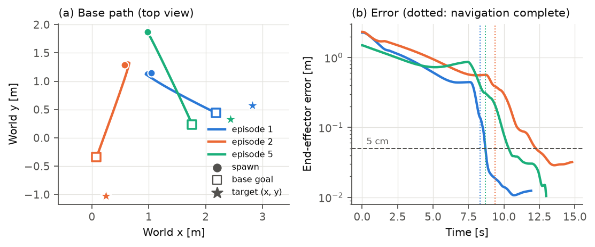

# Robotnik Mobile Manipulator: MLP Policy Trained with DAgger (V6)

A simulated Robotnik mobile manipulator (4-wheel skid-steer base + 7-DoF Kinova arm, PyBullet + Pinocchio) is spawned anywhere on the floor with any heading. It has to drive to a target-dependent standoff pose and reach a 3D target with its gripper. Three MLPs imitate a model-based expert controller and are trained with **Dataset Aggregation (DAgger)**, so they also learn to recover from their own mistakes.

**Final model:** [`trained_model_dagger_v6/`](trained_model_dagger_v6)

| 1000 random episodes (same test cases as the linear-regression model) | V6 |
|---|---:|
| Success (final error ≤ 5 cm) | **90.0 %** (900/1000, 95 % CI [88.0, 91.7] %) |
| Strict success (≤ 2 cm) | 56.5 % |
| Median / mean final error | 18.0 mm / 79.0 mm |
| Mean time per successful episode | 14.2 s |
| Parameters (3 networks) | 342,674 |
| Inference time per 1 ms control step (CPU) | 0.21 ms |

Spawn x, y ∈ [−2, 2] m with any heading; target 0.9–3.5 m from the spawn, height 0.3–0.9 m. 76 % of these targets lie outside the region used for training. The method and every design choice are explained in `main.tex` (Section "Approach 2: MLP Policy with DAgger").

## Demo video

The V6 policy drives from a random spawn pose to a random target and reaches it with the arm. Wheels and arm are fully learned; the expert is not used.

<video src="media/v6_random_spawn_demo.mp4" controls muted width="720"></video>

[](media/v6_random_spawn_demo.mp4)

**▶ [Play the demo video (`media/v6_random_spawn_demo.mp4`)](media/v6_random_spawn_demo.mp4)**. The image above shows three example episodes (base path and end-effector error) and links to the video.

To record your own run, use the GUI command below and capture the PyBullet window (e.g. with OBS or `SimpleScreenRecorder`).

## Quick start

All commands run from `robotnik_arm_task/robotnik_dagger_v5/` inside the project's Pixi `ml` environment (`pixi run -e ml ...`, or `pixi shell -e ml` once). The demonstrations are expected in `../data_randomized/` (only needed for training).

**Watch the policy in the PyBullet GUI.** Each run uses a new random target and spawn:

```bash
pixi run -e ml python run_robotnik_v6.py --random-target --random-spawn --seed $RANDOM
```

Use a given target and start pose instead:

```bash
pixi run -e ml python run_robotnik_v6.py --target 1.2 -0.8 0.6 --spawn-position -1.5 1.5 3.0
```

The runner prints `SUCCESS | reached` once the gripper has stayed within 5 cm of the target for 30 ms. It also writes a JSON summary to `custom_target_demo/`. Add `--headless` to run without a window.

## How it works (short version)

| Network | Input | Output |
|---|---|---|
| Wheel MLP | 38 egocentric features | 4 wheel speeds (rad/s) |
| Arm HOLD MLP (before navigation completes) | 38 features + joint state 10 ms and 30 ms earlier = 66 | 7 joint torques (N·m) |
| Arm REACH MLP (after navigation completes) | same 66 | 7 joint torques (N·m) |

All three networks are 256 → 256 → 128, ReLU, dropout 0.1, with unscaled inputs.

- **Egocentric features** (`v6_features.py`): the goal, target and gripper are given in the robot's base frame, the heading errors as sin/cos, and the reaching error target − gripper is included explicitly. The policy is therefore independent of where on the floor the task happens.
- **Phase switch**: a latched navigation-complete flag selects HOLD or REACH.
- **Time-based history**: the arm lags are in seconds. Every dataset is resampled to 10 ms rows, so the history means the same thing in training and at deployment (1 ms steps).
- **Expert** (`robotnik_arm_control.py`): an align → drive → orient state machine for the base; damped-least-squares IK + PD control with gravity compensation (Kp = 100, Kd = 30, ±30 N·m) for the arm. It is used for labels only, never at deployment.
- **DAgger** (`robotnik_dagger_collect.py`, `train_v6.py`): three rounds on random tasks (spawn x, y ∈ [−2, 2] m, any yaw; target radius 0.4–1.8 m, height 0.2–1.2 m):

  | Round | Wheels / arm driven by | β (expert share) | Learner | Rollouts |
  |---|---|---|---|---:|
  | r0 | expert | 1 | – | 400 |
  | r1 | mix, 0.3 s intervals | 0.5 | V6-r0 | 600 |
  | r2 | learner | 0 | V6-r1 | 600 |

  After each round, every network is retrained (warm-started) on the 1400 training demonstrations plus all rollouts so far. The expert's action is always the label.

## Reproduce

```bash
# full pipeline: 3 collection rounds + 3 trainings + evaluation + figures (~4 h with 6 workers)
pixi run -e ml bash run_v6_pipeline.sh
# or stage by stage: r0 train_r0 r1 train_r1 r2 train_r2 eval
pixi run -e ml bash run_v6_pipeline.sh train_r2
WORKERS=4 pixi run -e ml bash run_v6_pipeline.sh     # fewer parallel simulations if RAM is tight
```

Every stage is resumable: finished episodes and trained models are skipped. Progress bars show the episodes, epochs and batches. `train_v6.py` caches parsed rollouts in `cache_v6/`. The train/validation/test split of the 2000 demonstrations is in `episode_split.json`; the 300 test episodes are never used.

**Evaluation only** (on the 1000 linear-model test cases):

```bash
pixi run -e ml bash run_v6_evaluation.sh   # -> eval_v6/linear_protocol/*/deploy_summary.csv, figures/v6_*.pdf, figures/v6_results.json
```

`make_linear_protocol_cases.py` regenerates the cases with the same random sequence (seed 42) as the linear model's `test_combined_random.py`. `robotnik_dagger_collect.py --stop-rule linear` applies the same stop rule: stop at 1 cm, or when the error stalls for 1.5 s, or at 40 s; success = final error ≤ 5 cm.

## Files

| File | Purpose |
|---|---|
| `robotnik_dagger_collect.py` | simulation loop: DAgger collection (`--mode collect`), deployment/evaluation (`--mode deploy`), parallel `--workers`, `--resume` |
| `robotnik_arm_control.py` | expert controller (base state machine, IK + PD arm) and the stop criteria |
| `dagger_common.py` | the 38 raw logged features, the 11 outputs, the MLP class |
| `v6_features.py` | egocentric feature transform, 10 ms resampling, runtime policy `V6Policy` |
| `train_v6.py` | trains the wheel, HOLD and REACH networks |
| `run_v6_pipeline.sh` | the complete DAgger pipeline |
| `run_v6_evaluation.sh`, `make_linear_protocol_cases.py`, `plot_v6_results.py` | evaluation and figures |
| `run_robotnik_v6.py` | single-episode GUI runner |
| `test_random_sampling.py` | unit tests for the target/spawn samplers (`python test_random_sampling.py`) |
| `trained_model_dagger_v6/` | **final policy**; `trained_model_dagger_v6_r0/`, `_r1/` are the checkpoints of DAgger rounds 0 and 1 |
| `main.tex`, `figures/` | report and figures |

The DAgger rollouts (`arm_dagger_v6_r*/`, about 4 GB) and the cache are not in git; `run_v6_pipeline.sh` regenerates them.

## How we got to V6 (trial and error)

| Version | What changed | What we learned |
|---|---|---|
| V2 | behaviour cloning: one wheel MLP + one arm MLP on 38 raw world-frame features | one arm network has to fit both the "hold" and the "reach" regime |
| V4 | phase-gated HOLD/REACH arm networks + joint history | still behaviour cloning: errors on the states the learner reaches by itself are never corrected |
| V5, V5.3 | two arm-DAgger rounds (β = 0.5, then 0) on the demonstration targets, wheels driven by the expert | 93 % on the demonstration targets, but only 6 % when the robot spawned up to 2 m away |
| V5.4 | third arm-DAgger round on random targets | no gain: 1400 new rollouts outweighed the earlier ones 9:1, and the wheels were still never corrected |
| **V6** | egocentric features, DAgger on wheels **and** arm, spawns in a 4 × 4 m square, lags in seconds, 45 s navigation timeout, balanced data | reaches targets from random spawns; results above |

The V6 diagnosis found five causes of the random-spawn failures:
1. the demonstrations only spawn within ±0.25 m and last 8 s;
2. the wheel network was never DAgger-trained;
3. the inputs were world coordinates;
4. the history lags were 100/300 ms in the 10 ms demonstrations but 10/30 ms at deployment;
5. the 20 s step cap and 25 s timeout cut long drives short.

The earlier code is in the git history of this branch (commit `5bdfe14` and before).

## Troubleshooting

- **No PyBullet window:** you need a desktop session; on a headless machine use `--headless`.
- **`... is not a V6 checkpoint`:** `--model-dir` must contain `v6_metadata.json`, `wheel.pth`, `arm_hold.pth` and `arm_reach.pth`.
- **Out of memory during collection:** lower `WORKERS`. Each simulation uses about 1 GB of RAM.
- **`pixi` not found / no `ml` environment:** install Pixi and use the project's `RoboEnv` manifest. The `simulation_and_control` package must be importable.
