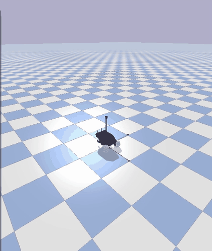
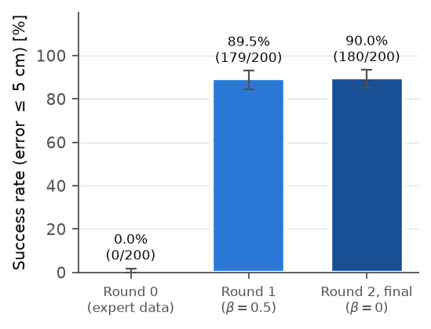
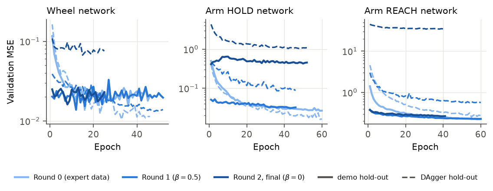
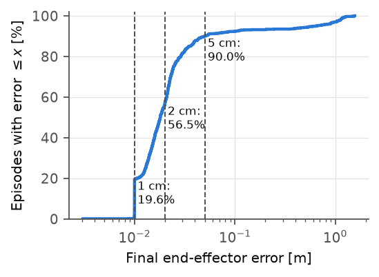

# Robotnik Mobile Manipulator: MLP Policy Trained with DAgger (V6)

A simulated Robotnik mobile manipulator (4-wheel skid-steer base + 7-DoF Kinova arm, PyBullet + Pinocchio) is spawned anywhere on the floor with any heading. It has to drive to a target-dependent standoff pose and reach a 3D target with its gripper. Three MLPs imitate a model-based expert controller and are trained with **Dataset Aggregation (DAgger)**, so they also learn to recover from their own mistakes.

**Final model:** [`trained_model_dagger_v6/`](trained_model_dagger_v6)

| 1000 random episodes (same test cases as the linear-regression model) | V6 |
|---|---:|
| Success (final error ≤ 5 cm) | **90.0 %** (900/1000, 95 % CI [88.0, 91.7] %) |
| Strict success (≤ 2 cm) | 56.5 % |
| Median / mean final error | 18.0 mm / 79.0 mm |
| Mean time per successful episode | 14.2 s |
| Parameters (3 networks) | 342,674 |
| Inference time per 1 ms control step (CPU) | 0.21 ms |

Spawn x, y ∈ [−2, 2] m with any heading; target 0.9–3.5 m from the spawn, height 0.3–0.9 m. 76 % of these targets lie outside the region used for training. The method, the theory and every design choice are explained in [Why DAgger](#why-dagger-the-theory) and [Technical details](#technical-details) below.

## Demo video

The V6 policy drives from a random spawn pose to a random target and reaches it with the arm. Wheels and arm are fully learned; the expert is not used.

<p align="center">
  
</p>

The animation plays at the speed of the screen recording (8 frames/s, cropped to the simulation view). The full-resolution screen recording is [`media/v6_random_spawn_demo.mp4`](media/v6_random_spawn_demo.mp4).

To record your own run, use the GUI command below and capture the PyBullet window (e.g. with OBS or `SimpleScreenRecorder`).

## Quick start

All commands run from `robotnik_arm_task/robotnik_dagger_v5/` inside the project's Pixi `ml` environment (`pixi run -e ml ...`, or `pixi shell -e ml` once). The demonstrations are expected in `../data_randomized/` (only needed for training).

**Watch the policy in the PyBullet GUI.** Each run uses a new random target and spawn:

```bash
pixi run -e ml python run_robotnik_v6.py --random-target --random-spawn --seed $RANDOM
```

Use a given target and start pose instead:

```bash
pixi run -e ml python run_robotnik_v6.py --target 1.2 -0.8 0.6 --spawn-position -1.5 1.5 3.0
```

The runner prints `SUCCESS | reached` once the gripper has stayed within 5 cm of the target for 30 ms. It also writes a JSON summary to `custom_target_demo/`. Add `--headless` to run without a window.

## Why DAgger (the theory)

At every 1 ms step the robot is in a state s_t and the policy π_θ must output a = [4 wheel speeds, 7 joint torques] that imitates the expert's action a* = E(s_t).

- **Behaviour cloning (BC)** trains only on states the expert visits. A small learner error leads to a state the expert never visited. There the network errs more, and the errors **compound**. For a horizon of T steps and a per-step error ε, BC can accumulate O(T²ε) cost (Ross et al., AISTATS 2011). Here T is 10,000–20,000 steps.
- **DAgger** lets the *learner* drive, asks the expert what it would have done in every state the learner actually reaches, adds these expert-labelled states to the training set, and retrains. This targets the learner's own state distribution, min_θ E_{s∼d_π}[ℓ(π_θ(s), E(s))], and achieves O(Tε). Because d_π depends on θ, it is approximated by a collect → aggregate → retrain loop.
- **Mixing:** in a "mix" round, one draw b ~ Bernoulli(β) every M steps decides whether the expert or the learner drives the next M steps. The **label is always the expert's action**, whoever drove.
- **Aggregation:** D_{k+1} = D_k ∪ {(features, expert action) of the states visited in round k}. D_0 is the 1400 training demonstrations.
- **Stateful expert:** the expert has hidden state (its base phase and arm reference q_des). The collector therefore advances it on *every* step, including learner steps, so its labels stay consistent.

**Evidence that it matters here:** after round 0 (pure behaviour cloning on expert data) the policy reaches **0 of 200** test targets. Every episode ends with the arm torques diverging (joint-velocity guard). After one DAgger round with the learner in control half of the time, it reaches **179/200**, and after the final round **180/200**.



**Why this β schedule** (decaying β, as recommended by Ross et al.):
- **r0, β = 1:** expert data for long drives and large turns. The 8 s demonstrations (spawns within ±0.25 m) contain none.
- **r1, β = 0.5, M = 0.3 s:** an immature learner in full control often fails early, which wastes the rollout. Alternating 0.3 s segments let it drift into slightly wrong states that the expert then recovers from, and those states are labelled.
- **r2, β = 0:** samples exactly the distribution the deployed policy meets.

The wheels take part in the mixing (earlier versions only corrected the arm), so the base also learns to correct its own drift.

**Loss.**
- The wheel network uses the mean squared error.
- Each arm network is trained only on rows of its own phase, with L = (1/N) Σ [ w_i · ‖π(x_i) − τ*_i‖²/7 + λ · m_i · ‖π(x_i) − π(x_{i−1})‖²/7 ].
- w_i = 5 for REACH rows within 0.35 m of the target, otherwise 1. The final approach decides success but is a small fraction of the rows.
- The smoothness term (λ = 0.01, m_i = 1 if the previous row is in the same phase) discourages jerky torques that would trip the velocity guard.

## Strengths and cost compared with the linear-regression model

Both were tested on the same 1000 random episodes with the same stop rule.

- **The linear model** reaches every target with millimetre accuracy. It gets there through task-specific engineering: 40 hand-designed features, data filtering, DART noise injection and a hand-tuned parking rule. All of these must be redesigned if the task or the expert changes.
- **The DAgger MLP** learns the *complete* controller (driving, parking and reaching) from data, with only a generic egocentric transform. It learns to recover from its own mistakes (BC alone: 0 %, DAgger: 90 %), and it generalises to targets far outside its training region. It would adapt to a new expert simply by collecting new data.
- **The price is a slow and tedious training process:**
  - six versions of trial and error;
  - every DAgger round needs hundreds of full closed-loop simulations with the expert queried every 1 ms (1600 rollouts, about 3.2 h on six CPU cores);
  - GPU training per round (44 min for the final round), against 1.8 s for the linear least-squares fit;
  - the β schedule, the data balance and the lags had to be tuned, each change needing a new collect → train → evaluate cycle;
  - 342,674 parameters instead of 246, and 0.21 ms per control step instead of 0.03 ms.
- **Lower precision** (median 18 mm): rollouts end 30 ms after entering the 5 cm band, so few training rows show the final convergence.

## How it works (short version)

| Network | Input | Output |
|---|---|---|
| Wheel MLP | 38 egocentric features | 4 wheel speeds (rad/s) |
| Arm HOLD MLP (before navigation completes) | 38 features + joint state 10 ms and 30 ms earlier = 66 | 7 joint torques (N·m) |
| Arm REACH MLP (after navigation completes) | same 66 | 7 joint torques (N·m) |

All three networks are 256 → 256 → 128, ReLU, dropout 0.1, with unscaled inputs.

- **Egocentric features** (`v6_features.py`): the goal, target and gripper are given in the robot's base frame, the heading errors as sin/cos, and the reaching error target − gripper is included explicitly. The policy is therefore independent of where on the floor the task happens.
- **Phase switch**: a latched navigation-complete flag selects HOLD or REACH.
- **Time-based history**: the arm lags are in seconds. Every dataset is resampled to 10 ms rows, so the history means the same thing in training and at deployment (1 ms steps).
- **Expert** (`robotnik_arm_control.py`): an align → drive → orient state machine for the base; damped-least-squares IK + PD control with gravity compensation (Kp = 100, Kd = 30, ±30 N·m) for the arm. It is used for labels only, never at deployment.
- **DAgger** (`robotnik_dagger_collect.py`, `train_v6.py`): three rounds on random tasks (spawn x, y ∈ [−2, 2] m, any yaw; target radius 0.4–1.8 m, height 0.2–1.2 m):

  | Round | Wheels / arm driven by | β (expert share) | Learner | Rollouts |
  |---|---|---|---|---:|
  | r0 | expert | 1 | – | 400 |
  | r1 | mix, 0.3 s intervals | 0.5 | V6-r0 | 600 |
  | r2 | learner | 0 | V6-r1 | 600 |

  After each round, every network is retrained (warm-started) on the 1400 training demonstrations plus all rollouts so far. The expert's action is always the label.

## Technical details

### Expert controller (`robotnik_arm_control.py`)

**Base goal.** The target is given in the world frame. The base goal lies on the ray from the world origin through the target, a standoff distance σ(z) short of it, with goal bearing θ_goal = atan2(y_t, x_t). σ(z) is piecewise linear in the target height:

| target height z (m) | 0.1 | 0.5 | 1.1 | 1.25 |
|---|---:|---:|---:|---:|
| standoff σ (m) | 0.80 | 0.65 | 0.65 | 0.35 |

Higher targets are approached more closely.

**Navigation signals:**
- d = |p_goal − p_base|;
- heading error = wrap(atan2(Δy, Δx) − ψ): the turn needed to face the goal point;
- orientation error = wrap(θ_goal − ψ): the turn needed to reach the final heading;
- navigation flag c = [d < 0.08 m and |orientation error| < 0.05 rad] or t > 45 s. The timeout was raised from 25 s because drives from 4 m away take up to about 30 s at 0.25 m/s.

**Base state machine.**

| Phase | Command | Leaves when |
|---|---|---|
| align | turn in place, ω = clip(3 · heading error, ±1 rad/s) | \|heading error\| < 0.05 rad |
| drive | v = clip(1.0 · d, 0.05, 0.25) · max(0, cos heading error) m/s; ω = clip(1.5 · heading error, ±0.3 rad/s) | d < 0.08 m, or the goal is passed (d < 0.15 m and the goal is behind) |
| orient | ω = clip(3 · orientation error, ±1 rad/s) | \|orientation error\| < 0.05 rad |
| done | wheels at zero | — |

Wheel speeds: ω_L,R = (v ∓ ω·B/2)/r, with r = 0.11 m and B = 0.66 m (track width calibrated for skid-steer). They are ordered [R, L, L, R] and clipped to ±3.18 rad/s.

**Arm.**
- **HOLD mode** (base not done): q_des = q_init.
- **REACH mode:**
  - The target is clamped to 0.85 m from the shoulder.
  - v_cart = 1.5 · (target − EE), with its norm capped at 0.25 m/s.
  - Damped least squares: q̇_des = Jᵀ(JJᵀ + λ²I)⁻¹ v_cart. λ is interpolated from 0.10 (smallest singular value of J = 0) to 0.01 (≥ 0.15).
  - Joints within 0.05 rad of a limit that the solution would push further are frozen, and the system is re-solved (up to 7 passes).
  - q̇_des is scaled to at most 1 rad/s per joint.
  - q_des is integrated, kept within ±0.15 rad of q (anti-windup), and kept 0.05 rad inside the limits.
- **Torque:** τ = clip(100 · (q_des − q) + 30 · (q̇_des − q̇) + g(q), ±30 N·m).
- **Fingers:** position-held at 0.1 rad.

The expert is stateful (base phase, q_des), so the collector advances it on every step, including learner steps.

### Features and networks (`v6_features.py`, `dagger_common.py`)

The 38 egocentric inputs:

| Group | Count | Content |
|---|---:|---|
| goal | 2 | forward, left offset of the base goal |
| target | 3 | forward, left, up offset of the target |
| end-effector | 3 | forward, left, up offset of the gripper |
| reaching error | 3 | target − gripper in the base frame |
| distance to goal | 1 | d |
| angles | 4 | sin/cos of heading error and of orientation error |
| arm state | 21 | q, q̇, q_init (7 each) |
| phase | 1 | latched navigation flag |

- **Why the base frame:** the right command depends only on where the goal and target are *relative to the robot*. With body-frame inputs a goal 1 m ahead looks the same anywhere on the floor (in world coordinates the correlation with wheel speed is r = −0.01; in the body frame it is r = +0.79). This invariance is why the policy generalises outside its training area.
- **Why the explicit reaching error:** the expert's Cartesian command is proportional to it, so the network does not have to learn a subtraction of two large, correlated inputs.
- **Why sin/cos:** a raw angle jumps by 2π at ±π although nothing physical changes; (sin, cos) is continuous.
- **Why separate HOLD/REACH networks:** holding a pose and reaching a target are different control laws, and one network fitted to both blurs them (regime mixing). The network is selected by the *latched* navigation flag ĉ_t = max_{τ≤t} c_τ, which stays at 1 once navigation is complete even if small base drift makes the raw flag flicker.
- **Arm input:** the 38 features plus (q, q̇) from 10 ms and 30 ms earlier, i.e. 66 inputs.
- **Why q_init:** in HOLD mode the expert tracks q_init.
- **Why the history:** the expert's q_des integrates over the past, and the short history exposes velocity and acceleration trends.
- **Parameters:** wheel network 109,188; each arm network 116,743; 342,674 in total.
- **Feature contract:** `v6_metadata.json` stores the input and output names, and the loader refuses a checkpoint whose contract differs.

### DAgger rounds and training (`train_v6.py`)

| | r0 | r1 | r2 |
|---|---:|---:|---:|
| wheels / arm driven by | expert | mix (β = 0.5, M = 300 steps) | learner |
| learner checkpoint | – | V6-r0 | V6-r1 |
| rollouts (train / 5 % hold-out) | 381 / 19 | 565 / 35 | 571 / 29 |
| rollouts reaching the target | 398/400 | 594/600 | 537/600 |
| mean rollout length | 11.4 s | 11.7 s | 15.1 s |

- **Why M = 300 steps (0.3 s):** within one learner segment the base can travel at most 7.5 cm or turn 0.3 rad. That is enough to drift into realistic error states, while the expert can still recover.
- **Rollout logging:** every 10 ms, capped at 60 s.
- **Hold-out split:** 5 % of the rollouts, chosen by a CRC32 hash of the file name, so the choice does not depend on file order.
- **Data balance:** at most 1500 random rows (15 s) per episode, and per phase for the arm networks. Every episode weighs about the same, and the final mix of 1400 demonstrations and 1517 rollouts is roughly 1:1 (V5.4 failed partly because of a 9:1 imbalance).
- **Optimisation:**
  - AdamW, learning rate 5e-4, weight decay 1e-5, batch 2048, gradient-norm clipping at 1.0, seed 42.
  - At most 60 epochs; the learning rate is halved after 4 epochs without improvement.
  - Early stopping (patience 10) on the mean of the demonstration and DAgger hold-out MSE.
  - Rounds 1 and 2 are warm-started from the previous round and trained on the whole aggregate.
- **Training time** (GTX 1650): about 35 / 44 / 44 min for r0 / r1 / r2. The whole pipeline with collection took about 3.2 h.



The DAgger hold-out MSE (dashed) *rises* from round to round because the hold-out set changes. Later rounds contain learner-driven states in which the expert commands large, often saturated corrective torques. The demonstration hold-out MSE (solid) stays flat. Offline MSE is therefore not comparable across rounds; the closed-loop success per round is (r0 0/200, r1 179/200, r2 180/200 on the same test cases).

### Full evaluation results (1000 linear-protocol cases)

| Metric | V6 |
|---|---:|
| Success (≤ 5 cm) | 90.0 % (900/1000), 95 % Wilson CI [88.0, 91.7] % |
| Strict success (≤ 2 cm) / within 1 cm | 56.5 % / 19.6 % |
| Mean / median final error, all episodes | 79.0 / 18.0 mm |
| Mean / max final error of the successes | 18.5 / 49.9 mm |
| Max error, all episodes | 1.56 m |
| Mean episode time, successes | 14.2 s |
| Stops: reached 1 cm / stalled / 40 s step cap / safety guard | 196 / 731 / 73 / 0 |
| Inference per step (1 CPU thread, `benchmark_inference.py`) | 0.21 ms |



- **Generalisation:** 90.9 % (686/755) for targets beyond the 1.8 m training radius, 87.3 % (214/245) inside it.
- **Target height:** 82.6 % for low targets (z ≤ 0.45 m, which need the elbow-twist branch) and 92.6 % above.
- **DAgger rounds** (first 200 cases):
  - r0: 0/200, all ended by the joint-velocity guard;
  - r1: 179/200, with 6 velocity-guard and 6 step-cap stops;
  - r2: 180/200, with no guard stops.
- **Failure modes:**
  - 73 failures hit the 40 s cap, 62 of them with the spawn within 1 m of the base goal (52.3 % success there versus 96.9 % beyond 1 m). Replays show the base reaching its goal point but still 1.0–1.5 rad off the final heading. It drives on and circles (4–12 m of path) instead of turning in place, so navigation never completes and the arm never reaches.
  - 27 failures stall just outside the tolerance (median 7.0 cm).
- **Differences from the linear protocol:** the base goal is the expert's standoff pose rather than the spawn-bearing goal, and the safety guards count as failures. The test cases and the stop rule are identical (`make_linear_protocol_cases.py`, `--stop-rule linear`).


## Reproduce

```bash
# full pipeline: 3 collection rounds + 3 trainings + evaluation + figures (~4 h with 6 workers)
pixi run -e ml bash run_v6_pipeline.sh
# or stage by stage: r0 train_r0 r1 train_r1 r2 train_r2 eval
pixi run -e ml bash run_v6_pipeline.sh train_r2
WORKERS=4 pixi run -e ml bash run_v6_pipeline.sh     # fewer parallel simulations if RAM is tight
```

Every stage is resumable: finished episodes and trained models are skipped. Progress bars show the episodes, epochs and batches. `train_v6.py` caches parsed rollouts in `cache_v6/`. The train/validation/test split of the 2000 demonstrations is in `episode_split.json`; the 300 test episodes are never used.

**Evaluation only** (on the 1000 linear-model test cases):

```bash
pixi run -e ml bash run_v6_evaluation.sh   # -> eval_v6/linear_protocol/*/deploy_summary.csv, figures/v6_*.pdf, figures/v6_results.json
```

`make_linear_protocol_cases.py` regenerates the cases with the same random sequence (seed 42) as the linear model's `test_combined_random.py`. `robotnik_dagger_collect.py --stop-rule linear` applies the same stop rule: stop at 1 cm, or when the error stalls for 1.5 s, or at 40 s; success = final error ≤ 5 cm.

## Files

| File | Purpose |
|---|---|
| `robotnik_dagger_collect.py` | simulation loop: DAgger collection (`--mode collect`), deployment/evaluation (`--mode deploy`), parallel `--workers`, `--resume` |
| `robotnik_arm_control.py` | expert controller (base state machine, IK + PD arm) and the stop criteria |
| `dagger_common.py` | the 38 raw logged features, the 11 outputs, the MLP class |
| `v6_features.py` | egocentric feature transform, 10 ms resampling, runtime policy `V6Policy` |
| `train_v6.py` | trains the wheel, HOLD and REACH networks |
| `run_v6_pipeline.sh` | the complete DAgger pipeline |
| `run_v6_evaluation.sh`, `make_linear_protocol_cases.py`, `plot_v6_results.py` | evaluation and figures |
| `run_robotnik_v6.py` | single-episode GUI runner |
| `test_random_sampling.py` | unit tests for the target/spawn samplers (`python test_random_sampling.py`) |
| `trained_model_dagger_v6/` | **final policy**; `trained_model_dagger_v6_r0/`, `_r1/` are the checkpoints of DAgger rounds 0 and 1 |
| `figures/`, `eval_v6/`, `media/` | figures and metrics (`figures/v6_results.json`), evaluation summaries, demo video |
| `benchmark_inference.py` | single-process timing of one control step |

The DAgger rollouts (`arm_dagger_v6_r*/`, about 4 GB) and the cache are not in git; `run_v6_pipeline.sh` regenerates them.

## How we got to V6 (trial and error)

| Version | What changed | What we learned |
|---|---|---|
| V2 | behaviour cloning: one wheel MLP + one arm MLP on 38 raw world-frame features | one arm network has to fit both the "hold" and the "reach" regime |
| V4 | phase-gated HOLD/REACH arm networks + joint history | still behaviour cloning: errors on the states the learner reaches by itself are never corrected |
| V5, V5.3 | two arm-DAgger rounds (β = 0.5, then 0) on the demonstration targets, wheels driven by the expert | 93 % on the demonstration targets, but only 6 % when the robot spawned up to 2 m away |
| V5.4 | third arm-DAgger round on random targets | no gain: 1400 new rollouts outweighed the earlier ones 9:1, and the wheels were still never corrected |
| **V6** | egocentric features, DAgger on wheels **and** arm, spawns in a 4 × 4 m square, lags in seconds, 45 s navigation timeout, balanced data | reaches targets from random spawns; results above |

The V6 diagnosis found five causes of the random-spawn failures:
1. the demonstrations only spawn within ±0.25 m and last 8 s;
2. the wheel network was never DAgger-trained;
3. the inputs were world coordinates;
4. the history lags were 100/300 ms in the 10 ms demonstrations but 10/30 ms at deployment;
5. the 20 s step cap and 25 s timeout cut long drives short.

The earlier code is in the git history of this branch (commit `5bdfe14` and before).

## Troubleshooting

- **No PyBullet window:** you need a desktop session; on a headless machine use `--headless`.
- **`... is not a V6 checkpoint`:** `--model-dir` must contain `v6_metadata.json`, `wheel.pth`, `arm_hold.pth` and `arm_reach.pth`.
- **Out of memory during collection:** lower `WORKERS`. Each simulation uses about 1 GB of RAM.
- **`pixi` not found / no `ml` environment:** install Pixi and use the project's `RoboEnv` manifest. The `simulation_and_control` package must be importable.
